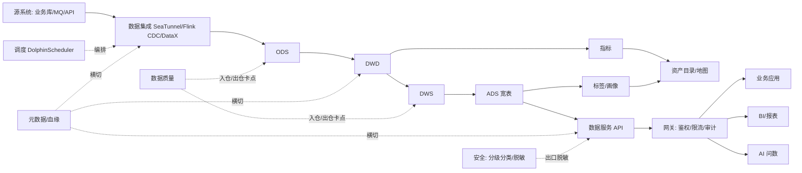

# 数据中台演进路线图（ROADMAP）

> 结论先行：**真正的数据中台 = 全域接入 + 统一治理 + 资产沉淀 + 服务化出口 + 资产门户** 的闭环，方法论祖师是阿里 OneData（OneModel/OneID/OneService）。
> 本项目现状是"活动业务中台"（管业务流程：登录/投票/抽奖），与数据中台（管数据本身：元数据/口径/质量/服务）的差距在**领域**而不在代码量。
> 调研基线：2026-10；完整调研报告见本文末尾来源。

## 一、中台是什么（方法论速览）

**OneData 三件套**（阿里）：

| 组件 | 解决什么 | 对应商业版模块 |
|---|---|---|
| **OneModel** 统一建模 | 指标口径混乱、重复建模 | 数据标准 / 数仓管理 / 数据指标 |
| **OneID** 实体打通 | 同一用户多 ID 孤岛 | 数据标签 / 主数据 |
| **OneService** 统一服务 | 取数靠人肉、接口重复开发 | 数据服务 |

概念层次：`存储(数仓/湖/湖仓一体) ← 流程(编排) ← 理念(Data Fabric) ← 价值(数据中台)`。**中台 ≠ 数仓**：数仓交付报表，中台交付可复用的数据服务与资产。2025-2026 共识：湖仓一体（Iceberg 为事实标准）做底，元数据先行，以服务 API 和 AI 问数为价值出口。

**三云官方能力框架的交集**（阿里 DataWorks / 华为 DataArts / 腾讯 WeData）= 8 大能力域：
`集成 / 开发 / 治理(元数据·标准·质量·安全) / 资产(目录·地图) / 指标 / 服务(API) / 可视化 / 运维` + 统一门户。这就是"真正的中台"检查表。

## 二、运行主链路



要点：纵向是"接入→分层加工→资产沉淀→服务出口"的生产链；横向治理（元数据/质量/标准/安全）横切每一跳；消费侧三类客户——人（BI/门户）、应用（API）、AI（问数）吃同一份资产目录。

## 三、商业版 14 模块 × 开源对照（哪些自研、哪些集成）

| 模块 | 成熟开源 | 策略 |
|---|---|---|
| 数据集成 | SeaTunnel（Apache 顶级）、DataX、Flink CDC | **集成** |
| 调度 | DolphinScheduler（Apache 顶级） | **集成** |
| 元数据 | DataHub、OpenMetadata、Atlas、SQLFlow（列级血缘） | Go 自研管控面，大了再换存储层 |
| 数据质量 | Datavines（27 种规则）、Great Expectations、Deequ | 规则清单抄 Datavines，Go 自研执行 |
| 可视化 | DataEase（国产拖拉拽）、Superset、Metabase | **集成，不自研报表设计器** |
| 数据服务 API | 阿里 OneService 范式、magic-api（动态 SQL 出接口）、APISIX/Higress | **Go 自研（本项目最有价值组件）** |
| 数据标准 / 标签 / 生命周期 / 主数据 | 无统治级开源 | **自研（模型简单，依赖业务落地）** |
| AI 问数 | DB-GPT、Wren AI、Vanna | 参考，语义层自研 |
| OLAP 底座 | Doris（实时更新/JSON 占优）/ StarRocks（湖仓查询占优） | Phase 3 引入 |
| 运维/日志 | Prometheus + Grafana + Loki / 夜莺 | **集成** |

**核心判断**：
1. 没有任何开源单体等于数据中台；中台 = 开源引擎 + **自研管控面/胶水层** + 治理流程。
2. **Go 写管控面（元数据/目录/服务 API/标签/指标/AI 编排），Java 开源做执行面（调度/同步/计算）**——不自研 DolphinScheduler/SeaTunnel 等效物（十人年工程），用 Go 服务通过 OpenAPI 驱动它们。
3. 本项目可复用资产：go-zero 网关+RPC 骨架、`beid` 多租户习惯、ES 依赖、用户体系（天然的标签/画像对象——有真实 To C 数据，比纯 B 端项目更有优势）。

## 四、分阶段路线

> 服务拆分沿用现有"网关 + rpc + model"模式；表名沿用 `dc_` 前缀 + `beid` 多租户字段。

### Phase 0：地基（已完成 ✅ 2026-10-10）
Go 1.26 / go-zero v1.10.3 / MySQL 8.4 / Redis 8 / etcd 3.5 / ES 7.17 全栈升级，详见 [UPGRADE.md](UPGRADE.md)。后续补：OpenTelemetry + Prometheus + Grafana + Loki（即"数据运维/系统日志"模块内核）。

### Phase 1：MVP 最小闭环（2-4 个月）——数据源 + 元数据 + 数据服务 API + 资产目录
价值闭环：**登记数据源 → 采集元数据/血缘 → 沉淀资产目录 → 配置出数据 API 给第三方调用**。

新增服务：`datasource-rpc`、`metadata-rpc`、`datasvc-rpc`、`catalog-rpc`。

核心表雏形：
```sql
dc_datasource(id, name, type ENUM('mysql','redis','es','http','kafka'), host, port,
  db_name, username, password_enc, params_json, status, owner, beid, ...)

dc_meta_entity(id, entity_type ENUM('database','table','column','api','metric','topic'),
  fqn VARCHAR(512) UNIQUE, name, comment, engine, rows_cnt, props_json,
  classification ENUM('L1','L2','L3','L4'), owner, beid, ...)

dc_meta_relation(id, rel_type ENUM('contains','lineage','depends'), from_id, to_id, props_json, beid)
dc_meta_version(entity_id, version, snapshot_json, published_at, operator)  -- 定版/对比

dc_api(id, name, path UNIQUE, mode ENUM('wizard','sql','register'), datasource_id,
  sql_text, script_js, params_json, cache_ttl,
  status ENUM('draft','published','offline'), owner, beid)
dc_api_app(id, app_key UNIQUE, app_secret_enc, name, rate_limit_qps, ip_whitelist, beid)
dc_api_grant(api_id, app_id, expire_at, field_mask, beid)

dc_asset(entity_id, category_id, asset_tags_json, visibility, beid)
dc_asset_category(id, parent_id, name, beid)
```

关键选型：
- 采集器：Go 直连 `information_schema`（MySQL）/ ES `_mapping` / Redis SCAN，一两天可出第一版；
- 血缘：先表级（集成任务/API 由本平台产生，写入时顺带登记，成本≈0）；列级后置对接 SQLFlow；
- 元数据存储：MySQL + 递归 CTE 撑到几千实体没问题，勿过早引入图数据库。

验收：第三方 App 拿 AppKey 调配置出来的 API；目录里能看到 API→表→数据源血缘链；L4 字段出口脱敏。

### Phase 2：质量 + 指标 + 标签（+3-6 个月）
新增 `quality-rpc`、`metric-rpc`、`tag-rpc`。
- 质量：规则分类抄 Datavines（行数/空值/唯一/值域/一致性/波动），go-zero job 服务执行，结果挂到资产目录"可信度"；
- 指标：原子指标 + 派生指标模型（阿里规范），指标可被数据服务引用成 API（**指标即服务**）；
- 标签：`app_user`/`base_member` 天然是标签对象；规则 SQL → 结果人群表起步，量大后切 Doris bitmap 圈群。

### Phase 3：集成开发 + 调度 + CDC（+6-12 个月）——集成开源，不自研
- 调度 → **DolphinScheduler**（`job-rpc` 对接其 OpenAPI 做运维视图）；同步 → **SeaTunnel**（批流一体）；实时 → **Flink CDC**；OLAP 底座 → **Doris**（与商业版同源）。
- `ide-svc`：SQL IDE 与版本管理，任务物化为 DS 工作流；拖拉拽 DAG 后置。
- 原则：本平台的元数据/血缘/质量**包住**开源引擎——每个同步任务自动登记血缘、挂入仓卡点。这是自研管控面的价值所在。

### Phase 4：可视化 + AI 问数（12 个月+）
- BI：集成 **DataEase**（贴合中文拖拉拽体验）或 Superset；知识图谱（Neo4j/NebulaGraph）后置。
- **AI 问数（2026 现状）**：裸 NL2SQL 直连库准确率仅 62%-79%（腾讯实测），业界已转向**语义层路线**——LLM 只负责把自然语言映射到预定义指标/维度（NL2Metric），SQL 由指标引擎确定性生成。可行链路：
  `问题 → 意图识别/改写(LLM) → 语义映射(向量检索命中指标/同义词，ES 即可起步) → 确定性生成查询 → 权限过滤+审查 → 走数据服务执行 → 结果+图表建议`
  LLM 永远不直接拿生产库连接串。**成立前提正是 Phase 1/2 的元数据与指标**——AI 问数是元数据工程的复利出口。

### 目标架构

```
datacenter-api(网关, 现有)
 ├─ user/votes/questions/search(现有业务 RPC, 不动)
 ├─ datasource-rpc  metadata-rpc  catalog-rpc          ← Phase 1
 ├─ datasvc-rpc(执行器) [+ APISIX/Higress 可选前置]      ← Phase 1
 ├─ quality-rpc  metric-rpc  tag-rpc                    ← Phase 2
 ├─ job-rpc(→DolphinScheduler)  ide-rpc                 ← Phase 3 (SeaTunnel/Flink CDC/Doris)
 └─ ai-rpc(→LLM 语义层)  [DataEase 外挂]                ← Phase 4
基础: MySQL(元数据/管控) + Redis + etcd + ES + Prometheus/Grafana/Loki
```

## 五、最务实的三句话

1. **别从数仓开始，从"元数据 + 数据服务"开始**——Phase 1 四件套用 go-zero 两三个月可形成可演示闭环；"先建 Doris"会卡在无数据可入。
2. **Go 写管控面，开源做执行面**——差异化价值（血缘打通、API 化、资产化、语义层）全在管控面，恰是 Go 擅长的。
3. **AI 问数是叙事主线与复利出口**——技术上 2026 年可行（语义层路线），商业上性感，前提是 Phase 1/2 老老实实做元数据与指标。

## 六、来源（节选）

- OneData 方法论：阿里云开发者社区、cnblogs.com/zsql
- 三云能力框架：help.aliyun.com（DataWorks）、huaweicloud.com（DataArts Studio）、cloud.tencent.com（WeData）
- 湖仓一体/演进：yunqi.tech、clouderacn.cn、databend.cn、aloudata.com、dtstack.com（数栈白皮书）
- 开源组件：DataHub、OpenMetadata、Apache DolphinScheduler/SeaTunnel/Atlas、Datavines、DataEase、Superset、APISIX、DB-GPT、Wren AI、Vanna（各官方仓库/官网）
- ChatBI 准确率：cloud.tencent.com《准确率是 ChatBI 的生命线》(2025-09)
- 本地现状：代码审读（14 张表全为 To C 活动业务，beid+ptyid 多租户雏形）
